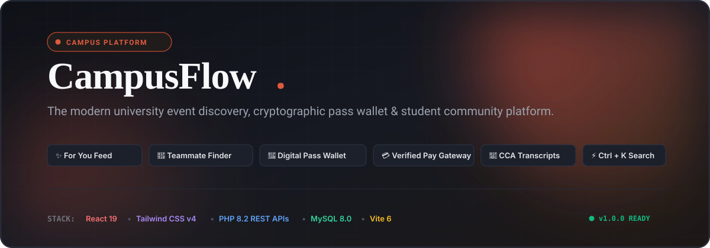
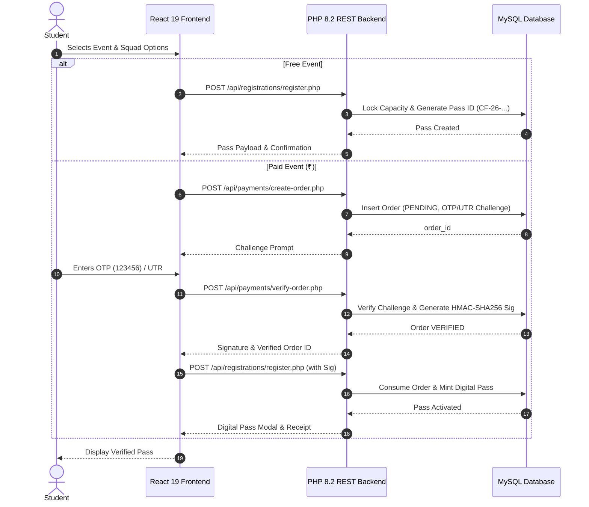

<p align="center">
  
</p>

<p align="center">
  <strong>The Complete Operating System for University Events, Student Communities &amp; Co-Curricular Life.</strong>
</p>

<p align="center">
  <a href="#-core-features"></a>
  <a href="https://react.dev/"></a>
  <a href="https://tailwindcss.com/"></a>
  <a href="https://www.php.net/"></a>
  <a href="https://www.mysql.com/"></a>
  <a href="#-license"></a>
</p>

---

## 📌 Table of Contents

- [✨ Why CampusFlow?](#-why-campusflow)
- [🚀 Signature Highlights](#-signature-highlights)
- [🧩 Feature Deep-Dives](#-feature-deep-dives)
  - [1. 🎯 Personalized "For You" Feed](#1--personalized-for-you-feed)
  - [2. 🤝 Campus Community & Teammate Finder](#2--campus-community--teammate-finder)
  - [3. 💳 2-Step Cryptographic Payment Gateway](#3--2-step-cryptographic-payment-gateway)
  - [4. 🎫 Digital Pass Wallet, Merit Certificates & CCA Transcript](#4--digital-pass-wallet-merit-certificates--cca-transcript)
  - [5. 📅 Personal Campus Calendar & Reminders](#5--personal-campus-calendar--reminders)
  - [6. 📁 Event Resource Hub & Q&A Discussion Boards](#6--event-resource-hub--qa-discussion-boards)
  - [7. ⚡ Global Command Palette (Ctrl + K)](#7--global-command-palette-ctrl--k)
- [📐 System Architecture & Flow](#-system-architecture--flow)
- [👥 Role-Based Workspaces](#-role-based-workspaces)
- [💻 Quick Start & Installation](#-quick-start--installation)
- [🔑 Demo Login Accounts](#-demo-login-accounts)
- [🤝 Contributing](#-contributing)
- [📄 License](#-license)

---

## ✨ Why CampusFlow?

Traditional campus event portals are static notice boards. Students miss out on hackathons, struggle to find teammates across different departments, lose physical certificates, and wait in manual registration queues.

**CampusFlow** reimagines campus life as an integrated, intelligent ecosystem:
- 🎯 **Learns what students care about** via personalized interest & community feeds.
- 🤝 **Connects people, not just listings** through consent-based attendee directories and squad codes.
- 💳 **Secures paid hackathons & workshops** using server-verified two-step challenge payments.
- 📜 **Powers student careers** with official printable Co-Curricular Activity (CCA) transcripts and verifiable certificates.

---

## 🚀 Signature Highlights

| Feature | Description | Tech Used |
| :--- | :--- | :--- |
| **Curated "For You" Feed** | Dynamic event recommendation scoring based on home department, followed clubs, and student interest tags. | MySQL Fulltext, React Memo |
| **Teammate Finder & Squad Codes** | Opt-in attendee directory with "Looking for Teammates" tags; join squads with `TEAM-XXXX` invite codes. | Relational Joins, State Sync |
| **2-Step Payment Gateway** | Card 6-digit OTP challenge & UPI 12-digit UTR verification with HMAC-SHA256 signature verification. | OpenSSL HMAC, PHP PDO |
| **Digital Pass Wallet** | Cryptographically indexed pass ID generation (`CF-26-DEPT-EVT-XXXXX`) with instant status transitions. | Transaction Locks, QR Engine |
| **Merit Certificates & CCA Passport** | Official printable Merit/Participation Certificates and comprehensive Activity Credit Transcripts. | CSS Print Media, SVG Seals |
| **Personal Campus Calendar** | Interactive monthly grid with personal reminder pins, checklist toggles, and `.ics` export. | ISO Date Utility, Color Tags |
| **Event Resource Hub** | Organizers attach Problem Statements, Slides, GitHub Repos, and Photo Galleries directly to events. | REST Endpoints, Safe Links |
| **Global `Ctrl + K` Palette** | Instant keyboard-driven search modal across events, announcements, departments, and workspace routes. | Window Event Dispatcher |

---

## 🧩 Feature Deep-Dives

### 1. 🎯 Personalized "For You" Feed
Instead of overwhelming students with every listing on campus, CampusFlow curates what matters to each individual:
- **Interactive Onboarding:** Students pick interests (`AI`, `Web`, `Hackathon`, `Cultural`, `Robotics`, `Design`, `Cybersecurity`) and select clubs to follow.
- **Feed Switcher:** Toggle between **"All Campus Events"** and **"Curated For You"** with 1 click.
- **Match Badges:** Contextual pills indicate why an event was recommended (`✦ Followed: AIML` · `✦ Interest: AI` · `✦ Your Dept: CSE`).

### 2. 🤝 Campus Community & Teammate Finder
Competitions and hackathons are team sports. CampusFlow makes squad formation seamless:
- **Consent-First Directory:** Students choose whether to appear in an event's Attendee Directory.
- **"Looking for Teammates" Badge:** Solo participants can display their skill set and pitch.
- **Join via Squad Code (`TEAM-XXXX`):** Squad leaders share their code; teammates enter it during registration to automatically synchronize roster details and receive linked passes.

### 3. 💳 2-Step Cryptographic Payment Gateway
Paid events, fest tickets, and prize-backed hackathons are protected against client tampering:
- **Order Generation:** Server registers a pending `payment_orders` challenge with a tamper-proof timestamp and attempt counter.
- **Verification Challenge:** Simulates realistic university payment rails (Credit/Debit Card with 6-digit OTP or UPI with 12-digit bank UTR).
- **HMAC-SHA256 Signature:** The pass is minted **only** after the server cryptographically validates the secret signature and permanently marks the order as consumed. Replay attacks are rejected.

### 4. 🎫 Digital Pass Wallet, Merit Certificates & CCA Transcript
- **Real-Time Pass Lifecycle:** Smooth transitions from `REGISTERED` ➔ `CONFIRMED` / `WAITLISTED` ➔ `ATTENDED`.
- **Podium Winners & Merit Seals:** Organizers award podium titles (`1st Place Winner`, `2nd Place Runner-Up`, `Finalist`).
- **Official CCA Transcript (Co-Curricular Passport):** A student can print or export a unified ledger summarizing all attended events, hackathons, and total calculated CCA credits for company interviews.

### 5. 📅 Personal Campus Calendar & Reminders
- Monthly view displaying both university events and personal study/prep notes.
- Color tags: **Vermilion** (Exams / Urgent), **Emerald** (Event Prep), **Amber** (Deadlines), and **Indigo** (Personal Notes).
- Single-click reminder pinning from any event details page.

### 6. 📁 Event Resource Hub & Q&A Discussion Boards
- **Resource Repository:** Direct access to problem statements, starter boilerplates, and lecture decks.
- **Discussion Board:** Questions, answers, and official organizer pinned responses.

### 7. ⚡ Global Command Palette (`Ctrl + K`)
- Press `Ctrl + K` or `Cmd + K` from anywhere in the app to search across events, departments, bulletins, or jump directly to your calendar or wallet.

---

## 📐 System Architecture & Flow



---

## 👥 Role-Based Workspaces

CampusFlow enforces strict role-based access control (RBAC) across 4 user tiers:

```
┌────────────────────────────────────────────────────────────────────────┐
│                        CAMPUSFLOW ROLES MATRIX                         │
├───────────────────┬──────────────┬─────────────┬─────────────┬─────────┤
│ Capability        │ Student      │ Organizer   │ Dept Mgr    │ Admin   │
├───────────────────┼──────────────┼─────────────┼─────────────┼─────────┤
│ Browse & For You  │      ✅      │     ✅      │     ✅      │   ✅    │
│ Register & Passes │      ✅      │     —       │     —       │   —     │
│ Teammate Finder   │      ✅      │     —       │     —       │   —     │
│ Personal Calendar │      ✅      │     ✅      │     ✅      │   ✅    │
│ Create / Edit Evt │      —       │     ✅      │     ✅      │   ✅    │
│ Entry Desk Verify │      —       │     ✅      │     ✅      │   ✅    │
│ Award Podium Cert │      —       │     ✅      │     ✅      │   ✅    │
│ Export Roster CSV │      —       │     ✅      │     ✅      │   ✅    │
│ Manage Dept Users │      —       │     —       │     ✅      │   ✅    │
│ System Analytics  │      —       │     —       │     —       │   ✅    │
└───────────────────┴──────────────┴─────────────┴─────────────┴─────────┘
```

---

## 💻 Quick Start & Installation

### Prerequisites
- **PHP 8.2+** with PDO MySQL & OpenSSL extensions (e.g. via XAMPP).
- **MySQL 8.0+** or MariaDB 10.4+.
- **Node.js 18+** & npm.
- **Git**.

### 1. Clone the Repository
```bash
git clone https://github.com/Samritcodes/campusflow.git
cd campusflow
```

### 2. Set Up the Database
Start MySQL (via XAMPP or terminal) and execute the schema and migrations in order:
```bash
# Create database
mysql -u root -e "CREATE DATABASE IF NOT EXISTS campusflow CHARACTER SET utf8mb4 COLLATE utf8mb4_unicode_ci;"

# Apply core schema and migrations
mysql -u root campusflow < backend/database/schema.sql
mysql -u root campusflow < backend/database/migration_payment_security.sql
mysql -u root campusflow < backend/database/migration_calendar_reminders.sql
mysql -u root campusflow < backend/database/migration_community_and_feed.sql
mysql -u root campusflow < backend/database/seed.sql
```

### 3. Configure the Backend
Ensure Apache or your PHP server serves the `backend/` directory:
- If using XAMPP, you can symlink or place the project under `htdocs`, or serve locally:
```bash
cd backend
php -S localhost:8000
```
*(Verify database credentials in `backend/config/database.php` if you use a MySQL password).*

### 4. Launch the Frontend
```bash
cd frontend
npm install
npm run dev
```
Open **`http://localhost:5173`** in your browser.

---

## 🔑 Demo Login Accounts

Pre-seeded accounts are available for test-driving each role:

| Role | Email | Password | Primary Workspace |
| :--- | :--- | :--- | :--- |
| **Administrator** | `admin@campusflow.edu` | `password123` | System Analytics, Roles, Bulletins |
| **Department Manager** | `hod.cse@campusflow.edu` | `password123` | CSE Department, Events, Approvals |
| **Organizer** | `sarah.organizer@campusflow.edu` | `password123` | Event Creation, Entry Desk, Rosters |
| **Student** | `rohan@campusflow.edu` | `password123` | For You Feed, Wallet, Calendar, Transcripts |

---

## 🤝 Contributing

Contributions, issues, and feature requests are welcome!

1. Fork the project.
2. Create your feature branch (`git checkout -b feat/amazing-feature`).
3. Commit your changes (`git commit -m "feat: add amazing feature"`).
4. Push to the branch (`git push origin feat/amazing-feature`).
5. Open a Pull Request.

---

## 📄 License

Distributed under the **MIT License**. See `LICENSE` for more information.

---

<p align="center">
  Made with ❤️ by <a href="https://github.com/Samritcodes">Samritcodes</a> for university communities everywhere.
</p>
